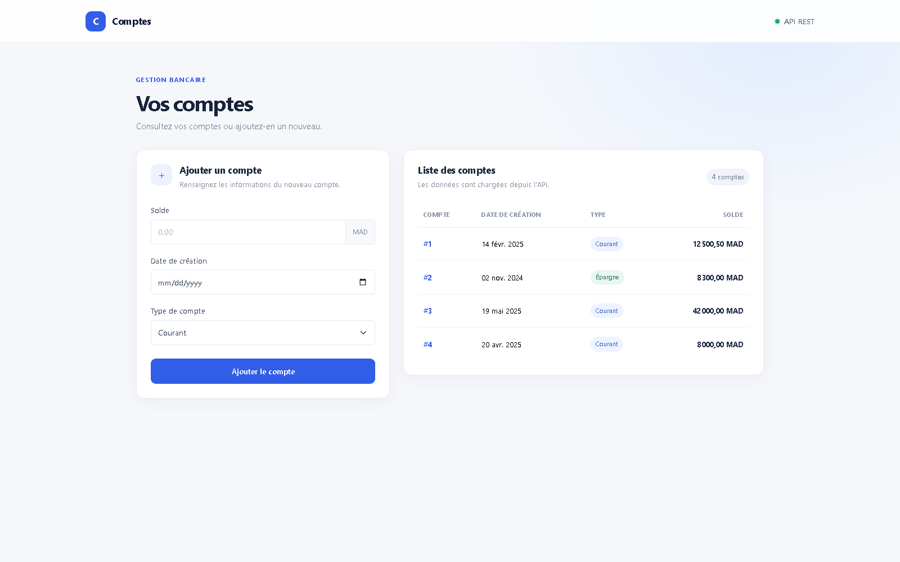
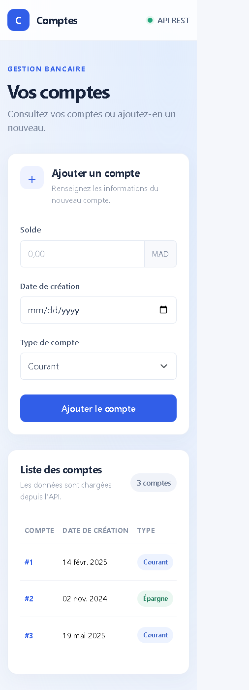

# Lab 9 — Client React pour API REST

Cette application React permet de consulter et d’ajouter des comptes via l’API REST ; les captures ci-dessous montrent l’interface avec des données de démonstration locales.

